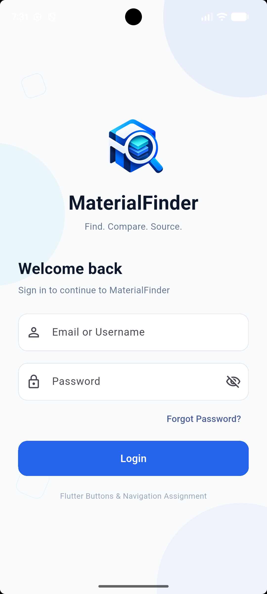
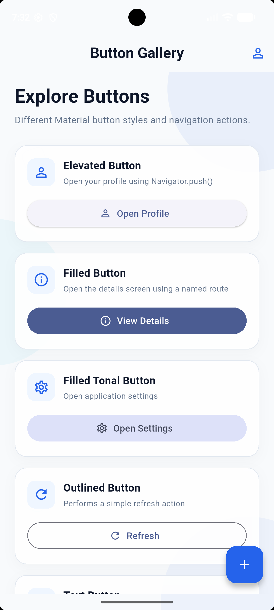
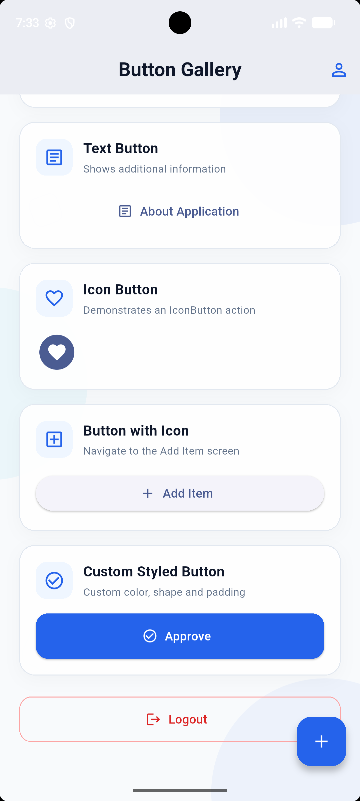
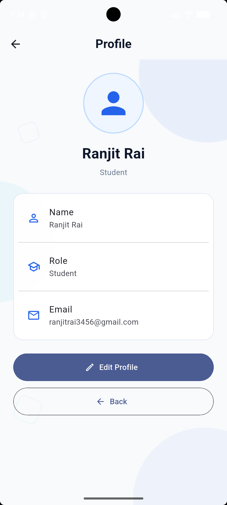
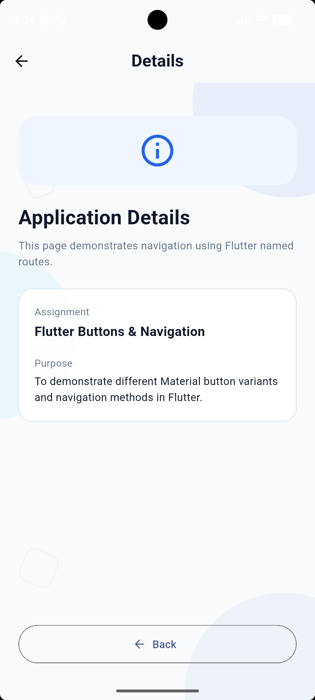
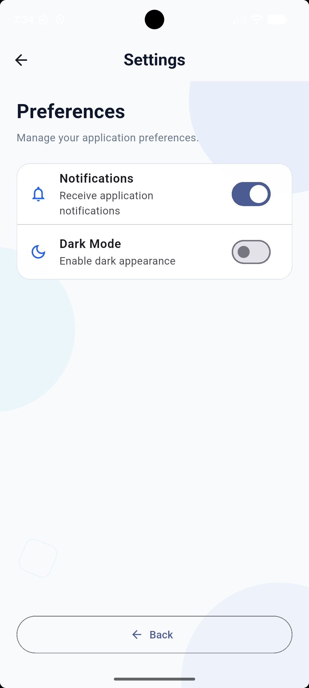
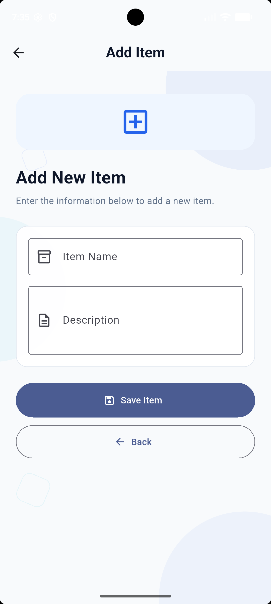

# Flutter Material Buttons & Navigation

A Flutter application created to demonstrate different Material Design button variants and navigation techniques.

The project includes a styled Login screen, Button Gallery, Profile, Details, Settings, and Add Item screens. It demonstrates different Flutter buttons, multiple screens, form validation, reusable widgets, and different navigation methods such as `Navigator.push()`, `Navigator.pop()`, `Navigator.pushReplacement()`, and named routes.

---

## Features

### Login Screen
- Custom MaterialFinder-style interface
- Email / Username field
- Password field
- Show / Hide password
- Basic form validation
- Custom background design
- Login navigation using `Navigator.pushReplacement()`

### Button Gallery
Includes different Material button variants:

- Elevated Button
- Filled Button
- Filled Tonal Button
- Outlined Button
- Text Button
- Icon Button
- Floating Action Button
- Button with Icon
- Custom Styled Button
- Logout Button

### Additional Screens
- Profile Screen
- Details Screen
- Settings Screen
- Add Item Screen

---

## Navigation Methods Used

### Navigator.push()

Used to open a new screen while keeping the previous screen in the navigation stack.

```dart
Navigator.push(
  context,
  MaterialPageRoute(
    builder: (context) => const ProfileScreen(),
  ),
);
```

### Navigator.pop()

Used to return to the previous screen.

```dart
Navigator.pop(context);
```

### Navigator.pushReplacement()

Used for Login → Button Gallery navigation so the user cannot return to Login using the Back button.

```dart
Navigator.pushReplacement(
  context,
  MaterialPageRoute(
    builder: (context) => const ButtonGallery(),
  ),
);
```

### Named Routes

Named routes are defined inside `MaterialApp`.

```dart
routes: {
  '/': (context) => const LoginScreen(),
  '/buttons': (context) => const ButtonGallery(),
  '/profile': (context) => const ProfileScreen(),
  '/details': (context) => const DetailsScreen(),
  '/settings': (context) => const SettingsScreen(),
  '/add': (context) => const AddScreen(),
},
```

Navigation using a named route:

```dart
Navigator.pushNamed(
  context,
  '/details',
);
```

---

## Technical Requirements Implemented

- `MaterialApp`
- `Scaffold`
- Multiple screens
- Multiple Material button variants
- `Navigator.push()`
- `Navigator.pop()`
- `Navigator.pushReplacement()`
- Named routes using `routes`
- `IconButton`
- `FloatingActionButton`
- Button containing an icon
- `SafeArea`
- Responsive scrollable layouts
- Reusable widgets
- Consistent Material Design styling

---

## Screenshots

### Login Screen



### Button Gallery - Top



### Button Gallery - Bottom



### Profile Screen



### Details Screen



### Settings Screen



### Add Item Screen



---

## Project Structure

```text
material_buttons_navigation/
├── assets/
│   └── images/
│       └── material_finder_logo.png
│
├── lib/
│   ├── screens/
│   │   ├── add_screen.dart
│   │   ├── button_gallery.dart
│   │   ├── details_screen.dart
│   │   ├── login_screen.dart
│   │   ├── profile_screen.dart
│   │   └── settings_screen.dart
│   │
│   ├── widgets/
│   │   ├── app_background.dart
│   │   └── custom_text_field.dart
│   │
│   └── main.dart
│
├── screenshots/
│   ├── add_item.png
│   ├── button_gallery_bottom.png
│   ├── button_gallery_top.png
│   ├── details.png
│   ├── login.png
│   ├── profile.png
│   └── settings.png
│
├── pubspec.yaml
└── README.md
```

---

## Technologies Used

- Flutter
- Dart
- Material Design / Material 3
- Android Studio
- Android Emulator
- Git
- GitHub

---

## Navigation Flow

```text
LOGIN
  |
  | Login Button
  v
BUTTON GALLERY
  |
  ├── Profile
  |
  ├── Details
  |
  ├── Settings
  |
  └── Add Item
```

The Back buttons on the additional screens use `Navigator.pop()` to return to the Button Gallery.

---

## Student Profile

**Name:** Ranjit Rai  
**Role:** Student  
**Email:** ranjitrai3456@gmail.com

---

## Assignment

**Flutter Buttons & Navigation**

This project was developed to demonstrate the use of different Flutter Material buttons and navigation techniques in a clean multi-screen application.

---

## Note

This project focuses on Flutter UI, Material Design buttons, and navigation.

The Login page uses frontend validation only and does not use Firebase, a database, or backend authentication.